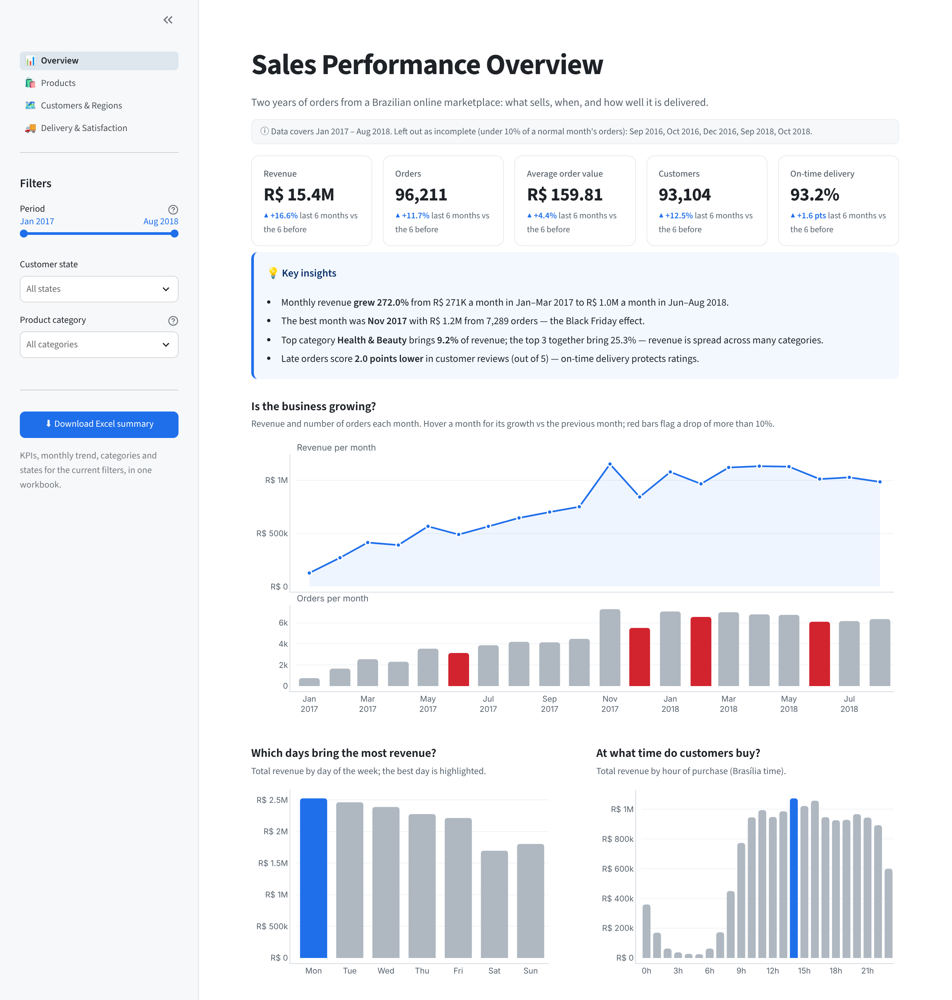
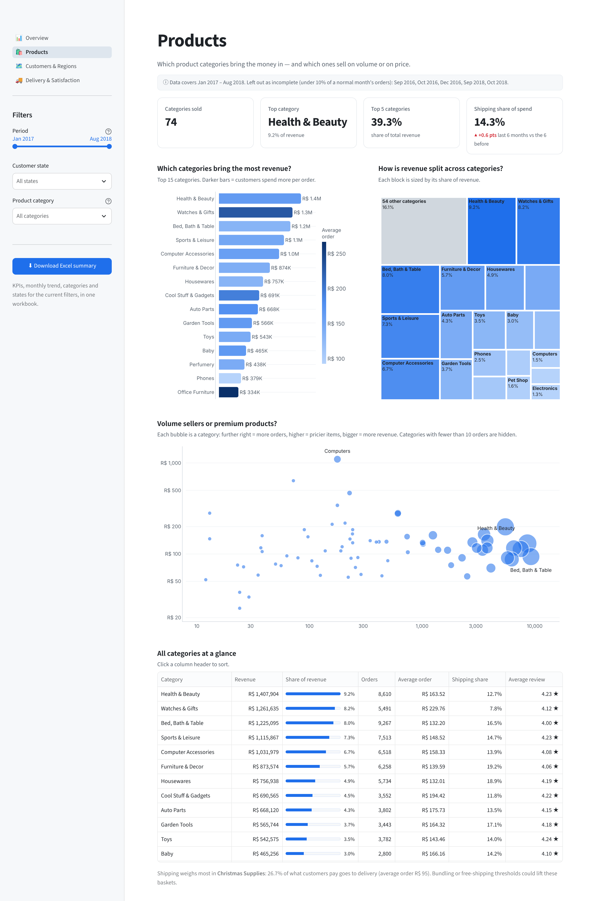
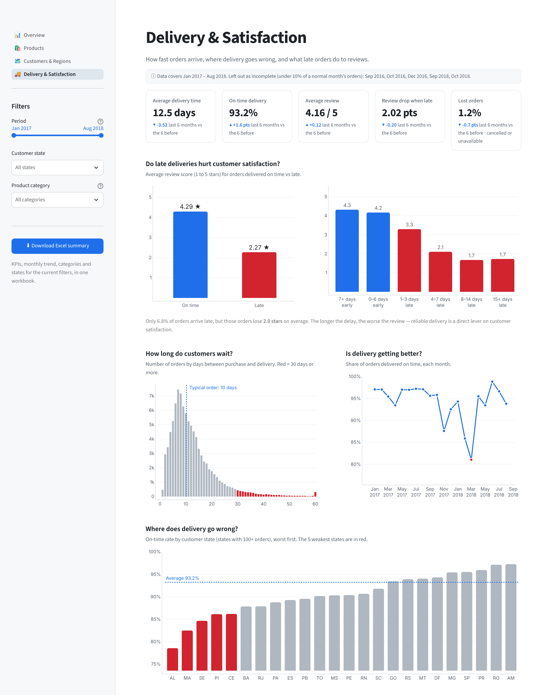

# E-commerce Sales Dashboard — Revenue, Products & Delivery Insights

**Live demo:** https://YOUR-APP-NAME.streamlit.app  ← *replace after deploying (see below)*



## The problem

A growing online store had two years of sales data spread across 8 files and no clear view of
what drives revenue. Which products sell? Where are the customers? Do customers come back? Are
late deliveries costing reviews? Answering any of these meant hours in spreadsheets.

## The solution

An **interactive dashboard** that answers those questions at a glance, plus a **one-click Excel
report** for meetings and accounting.

- **4 pages:** Overview · Products · Customers & Regions · Delivery & Satisfaction
- **Filters that apply everywhere:** period, customer state, product category
- **Every number compared** with the previous period, in plain business language
- **Key insights written automatically** from the data, updated with every filter
- **Download Excel summary:** KPIs, monthly trend, categories and states in one formatted workbook
- Incomplete months are detected and left out automatically, and the dashboard says so

## What it shows

Based on 96,211 delivered orders (Jan 2017 – Aug 2018, R$ 15.4M revenue):

- **Strong growth:** average monthly revenue grew **272%**, from R$ 271K a month (Jan–Mar 2017)
  to R$ 1.0M a month (Jun–Aug 2018). The best month was **November 2017 (R$ 1.2M)** — Black Friday.
- **Late deliveries destroy reviews:** on-time orders average **4.29 stars**, late ones **2.27**.
  Only 6.8% of orders arrive late, but more than a week late drops the score below 2 stars.
- **Delivery quality depends on the region:** 95.5% on-time in São Paulo, but only **78.5% in
  Alagoas** (24.5 days on average) — the North-East needs a better shipping partner.
- **Almost no repeat customers:** only **3.0%** of customers ordered twice. Almost all revenue
  comes from first-time buyers — a clear opportunity for retention campaigns.
- **Revenue is diversified:** the top category (Health & Beauty) brings only 9.2% of revenue;
  shipping costs take 14.3% of what customers pay, up to 27% in some categories.

## Screenshots

| Products | Delivery & Satisfaction |
|---|---|
|  |  |

More: [Customers & Regions](assets/screenshots/3_customers_regions.png) ·
[30-second demo of the filters](assets/filters_demo.mp4)

---

<details>
<summary><b>Run it yourself / technical notes</b></summary>

### Run locally

```bash
pip install -r requirements.txt
streamlit run app.py
```

The processed data is already in `data/processed/`, so the app runs straight away.

### Rebuild the data from the raw files

1. Download the **Brazilian E-Commerce Public Dataset by Olist** from Kaggle and unzip the CSVs
   into `data/raw/` (they are not committed).
2. `python scripts/build_data.py` — loads, cleans and joins the 8 files, prints a cleaning
   report, and writes compact parquet tables to `data/processed/` (about 3 seconds).

### Quality checks

```bash
pytest          # 31 tests: every KPI, the filters, the incomplete-month rule, data consistency
ruff check .    # lint
```

### Deploy (Streamlit Community Cloud)

1. Push this folder to a public GitHub repository.
2. On share.streamlit.io: **New app** → pick the repo → main file `app.py` →
   *Advanced settings* → Python 3.12 → **Deploy**.

**Why the processed data is committed:** the raw Kaggle files are 120 MB and need a Kaggle
login, so building them at startup would be slow and fragile. The processed tables are only
~9 MB (ids are replaced by compact integer codes), contain the full data rather than a sample,
and load in under a second. Raw CSVs stay out of git.

### How the numbers are defined

| Indicator | Definition |
|---|---|
| Revenue | Amount paid for delivered orders |
| Average order value | Revenue / orders |
| Repeat customer rate | Customers with 2+ orders in the period / all customers |
| On-time delivery | Orders delivered on or before the promised date |
| Review drop when late | Average review of on-time orders − average review of late orders |
| Shipping share | Shipping fees / (item prices + shipping fees) |
| Lost orders | Cancelled or unavailable orders / all orders placed |

When a category filter is on, each order counts only the items of the selected categories, so
category revenue always adds up to total revenue. Comparisons use the previous period of the same
length; when there is none (full history selected), the last 6 months are compared with the 6
before.

### Project structure

```
app.py                 entry point: filters, navigation, Overview page
pages/                 Products, Customers & Regions, Delivery & Satisfaction
src/load.py            read raw CSVs
src/clean.py           types, duplicates, missing values, latest review per order
src/build.py           joins -> analytical tables, incomplete-month detection
src/kpis.py            every KPI as a pure, tested function
src/filters.py         global filters, identical on every page
src/charts.py          all Plotly charts
src/export.py          Excel summary
src/ui.py              shared Streamlit layout pieces
scripts/build_data.py  runs the whole pipeline
tests/test_kpis.py     unit tests
```

</details>

---

*Built with Python, pandas, Plotly and Streamlit.*
